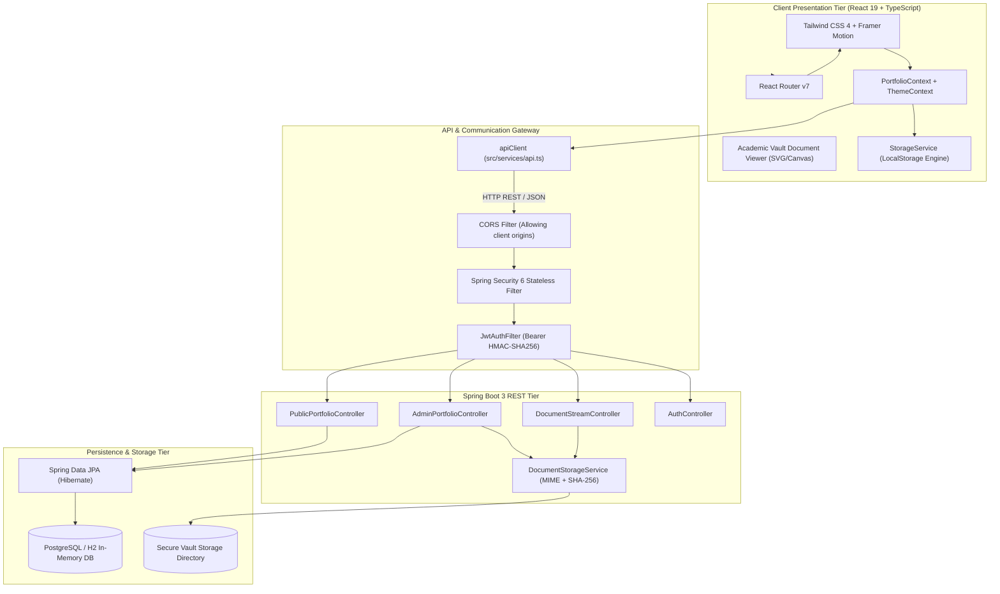

# System Architecture Document — Santu Nandi Developer Portfolio

This document outlines the architectural patterns, security models, data flows, and engineering decisions implemented across the portfolio and its microservice backend.

---

## 1. High-Level Architectural Diagram



---

## 2. Design System & Color Palette Strict Specification

The portfolio strictly adheres to the requested 3-color core visual identity:

| Token Name | Hex Code | Role in Application |
| :--- | :--- | :--- |
| **Ice Silver** | `#E8EDF2` | Primary light surfaces, high-contrast headings on dark aubergine backgrounds, document frames, fine borders, and neutral badge tags. |
| **Deep Aubergine** | `#301934` | Primary brand identity color, dark navigation headers, hero section radial backgrounds, cards, and modal dialog borders. |
| **Marigold** | `#F4B942` | Strategic accent color used for primary CTAs, active route indicators, verified shields, contest ratings, progress indicators, and interactive bounding boxes. |

---

## 3. The Academic Vault & Document Privacy Model

The Academic Vault enforces privacy and data integrity through a 3-tier visibility model:

```
+-------------------------------------------------------------------------------+
| LEVEL 1: PUBLIC METADATA                                                      |
| Institution, Degree, Passing Year, Score, Subject-by-Subject Score Breakdown  |
| (Always accessible to visitors and recruiters)                               |
+-------------------------------------------------------------------------------+
                                      |
                                      v
+-------------------------------------------------------------------------------+
| LEVEL 2: REDACTED PUBLIC PREVIEW                                              |
| High-fidelity SVG/Canvas render with candidate Roll No & Reg ID censored    |
| (Toggleable directly within the viewer interface)                             |
+-------------------------------------------------------------------------------+
                                      |
                                      v
+-------------------------------------------------------------------------------+
| LEVEL 3: PRIVATE ORIGINAL MASTER FILE                                         |
| Original PDF stored on backend disk / object store with SHA-256 checksum     |
| (Streaming only permitted through authenticated /api/documents endpoints)     |
+-------------------------------------------------------------------------------+
```

---

## 4. Production Engineering Case Studies

### 4.1 FoodyHub (AI-Powered Commerce)
- **Problem**: Concurrency bottlenecks on daily specials, payment spoofing risks, and generic menu discovery.
- **Solution**: Spring Boot 3 layered backend with `@Lock(LockModeType.PESSIMISTIC_WRITE)` for inventory consistency, Razorpay HMAC-SHA256 signature verification, and a structured prompt interface with Google Gemini 1.5 API.

### 4.2 PackSure (Automated Compliance Scanner)
- **Problem**: Manual physical label audits for Legal Metrology compliance are slow, error-prone, and cannot scale to millions of SKU updates.
- **Solution**: Two-tier architecture decoupling deep learning OCR (FastAPI + OpenCV + PaddleOCR) from statutory business rules (Spring Boot 3), featuring a human-in-the-loop review dashboard with interactive SVG bounding boxes.
